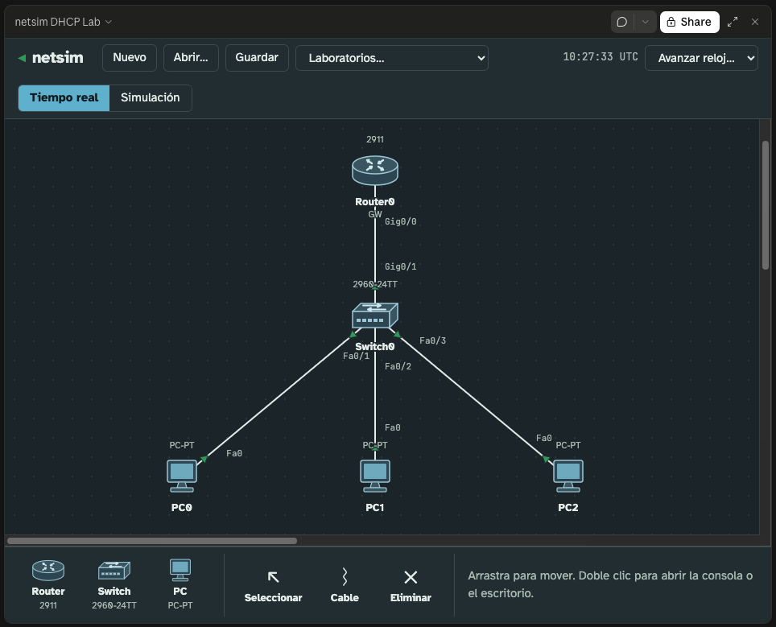

# netsim

Simulador de redes en el navegador inspirado en Cisco Packet Tracer, pensado para practicar
**DHCP en Cisco IOS** con la sintaxis, la ayuda contextual y las salidas del equipo real, y
**servicios de red en servidores** (DHCP, DNS, HTTP, correo y SSH) con terminales Linux y Windows.



- Área de trabajo lógica con routers 2911, switches 2960, PCs y **servidores Server-PT**, cables y luces de enlace.
- CLI de IOS completa para DHCP: pools de red y de host, `client-identifier`,
  `hardware-address`, reservas `address … client-id` / `address … hardware-address`,
  exclusiones, opciones, relay, snooping, cliente DHCP en interfaces y todos los `show`,
  `clear` y `debug`.
- DORA real con tramas Ethernet, ARP e IPv4 a través de switches, VLAN y routers.
- **Server-PT** con servicios DHCP, DNS, HTTP, SMTP/POP3/IMAP y SSH, configurables desde su
  pestaña Servicios o desde la terminal (`systemctl`, `sc`, `net start`).
- Terminal **GNU/Linux** con **GNU bash 5.3** de verdad (sintaxis, expansiones, funciones, arrays,
  redirecciones, historial, trabajos, scripts) sobre un sistema de ficheros Ubuntu con permisos y usuarios,
  utilidades GNU (`grep`, `sed`, `awk`, `find`, `sort`…) y los editores **nano** y **vim** a pantalla completa,
  también a través de SSH. Terminal **Windows** (cmd) en PCs y servidores; navegador web, cliente de correo
  y cliente SSH en los PCs.
- Pestaña **Documentación** con búsqueda: IOS, servicios de Server-PT, PC/Windows, Terminal Linux,
  nano, vim y la referencia de bash 5.3 (también `man` y `help` en la terminal).
- **Internet emulada** (v0.4): nube ISP con líneas de cable, xDSL y fibra (IP pública o router del operador
  con NAT y redirección de puertos), routers troncales que responden a `traceroute`, DNS públicos
  `8.8.8.8`/`8.8.4.4` que resuelven los dominios registrados en todas las nubes, y **NAT de IOS**
  (`ip nat inside/outside`, PAT, pools, NAT estático con puertos, ACL estándar).
- **Gestión web**: servidor HTTP de IOS en routers y switches (`ip http server`, Device Manager),
  **Roundcube** y una consola de administración web en Server-PT; Apache2 configurable en `/etc/apache2`.
- Modo simulación con lista de eventos (DHCP, DNS, ARP, ICMP, TCP, HTTP, SMTP, POP3, IMAP, SSH),
  animación paso a paso y la PDU de cada paquete.
- Guardar y abrir topologías completas en archivos `.json` (también la configuración de los servicios).
- Sin dependencias de ejecución: TypeScript compilado a módulos ES o a un único HTML.

## Uso rápido

```bash
npm install          # solo instala TypeScript (opcional si ya tienes tsc global)
npm run build        # dist/index.html + dist/netsim.html (archivo único, funciona sin servidor)
npm run serve        # http://localhost:8080
```

**Pruébalo online, sin instalar nada:**
**[▶ Abrir netsim DHCP Lab en el navegador](https://raw.githack.com/glopezca/netsim/main/demo/netsim-dhcp-lab.html)**

El enlace sirve [`demo/netsim-dhcp-lab.html`](demo/netsim-dhcp-lab.html), la aplicación completa en un
único archivo, a través de [raw.githack.com](https://raw.githack.com) (servicio externo; tras un push
puede tardar unos minutos en mostrar la última versión). También puedes descargar ese archivo y
abrirlo con doble clic, sin servidor ni conexión. `npm run build` lo regenera: tras cambiar el código,
haz commit de la nueva versión.
El menú **Laboratorios…** carga escenarios ya resueltos:

| Laboratorio | Qué practica |
|---|---|
| DHCP básico | `network`, `default-router`, `dns-server`, `domain-name`, `lease`, `excluded-address` |
| Reservas | pools `host` con `client-identifier` y con `hardware-address`; `address … client-id` en el pool de red |
| Relay | `ip helper-address`, `giaddr`, servidor en otra red |
| Router-on-a-stick | subinterfaces `encapsulation dot1Q`, trunk, un pool por VLAN |
| DHCP snooping | servidor falso bloqueado, `ip dhcp snooping trust`, opción 82 |
| Router como cliente | `ip address dhcp`, client-id `cisco-<mac>-<if>`, ruta por defecto AD 254 |
| Server-PT | DHCP, DNS, web (Apache), correo, SSH, Roundcube y gestión web en un servidor Ubuntu |
| Internet: dos sedes | Nubes ISP, NAT overload en un 2911, router del operador con redirección de puertos, dominio delegado (NS) y DNS públicos |

Interacción: doble clic en un dispositivo abre su consola (router/switch) o su escritorio
(PC). Herramienta **Cable**: clic en un dispositivo, elige puerto, clic en el otro.
En la consola funcionan `?`, `Tab`, flechas para el historial, `Ctrl+Z` y las abreviaturas
(`sh ip dhcp b`). El escritorio del PC muestra su **MAC** y su **Client-ID** listos para copiar
en `hardware-address` o `client-identifier`.

## Servidores Server-PT

Coloca un **Servidor** desde la paleta y haz doble clic. Pestañas:

| Pestaña | Qué hace |
|---|---|
| **Servicios** | Activa y configura cada servicio. Cada uno tiene su interruptor y su panel. |
| **Configuración IP** | IP estática o por DHCP, sistema operativo (Ubuntu o Windows Server), MAC y Client-ID. |
| **Terminal Linux** / **Símbolo del sistema** | Shell local del servidor. |

| Servicio | Configuración | Equivalente en el servidor real |
|---|---|---|
| **DHCP** | Pools al estilo Packet Tracer (IP inicial + usuarios máximos, gateway, DNS, dominio, TFTP, concesión), **reservas por MAC o por Client-ID**, concesiones automáticas identificadas por Client-ID o por MAC (`match-client-id`), «Reservar» desde la tabla de concesiones | `kea-dhcp4-server` · `/etc/kea/kea-dhcp4.conf` |
| **DNS** | Registros A, CNAME, MX, NS y TXT; dominio de la zona (`$ORIGIN`) con nombres **relativos** (`www`, `@`) que se autocompletan y **absolutos** acabados en punto (`srv.aula.lab.`); PTR automáticos; servidor autoritativo (NOERROR, NXDOMAIN, REFUSED) | `bind9` · `/etc/bind/db.<zona>` |
| **HTTP** | Ficheros editables (`index.html`, `ayuda.html`, …) también desde la terminal (`sudo nano /var/www/html/index.html`), 404, banner Apache o IIS según el SO | `apache2` · `/var/www/html` |
| **Correo** | SMTP, POP3 e IMAP por separado, dominio y usuarios; **reenvío entre dominios por MX** | `postfix` + `dovecot` |
| **SSH** | Usuarios y contraseñas; las sesiones abren la shell Linux o Windows del servidor | `ssh` · `/etc/ssh/sshd_config` |
| **Registros** | `journalctl -u <servicio>` de cada servicio | `journalctl` |

El servidor DHCP de Server-PT usa el mismo motor que el router IOS, así que funciona también a
través de un relay (`ip helper-address` apuntando al servidor).

### Terminales

**GNU/Linux (Ubuntu 26.04, GNU bash 5.3.20):**
- Un intérprete bash completo: comillas, expansiones de llaves, tilde, parámetros (`${v%%pat}`, `${v//a/b}`,
  `${v@Q}`…), aritmética, sustitución de órdenes y de procesos (y las nuevas `${ …; }` y `${| …; }` de 5.3),
  `if`/`case`/`for`/`while`/`select`, funciones, arrays indexados y asociativos, redirecciones y here-docs,
  `set -euxo pipefail`, `shopt`, historial (`!!`, `!$`, `^a^b`), alias, `trap`, trabajos, `PS1` en color y
  completado con Tab. Los mensajes de error son los de bash; un corpus de pruebas compara la salida con el bash real.
- Sistema de ficheros por equipo con permisos, `sudo` (pide la contraseña de la cuenta y la recuerda 15 min),
  `su`, usuarios y grupos; scripts con `#!/bin/bash`. Lo que escribas se guarda con la topología.
- Utilidades: `ls cat cp mv rm mkdir chmod chown ln find stat tree du df file head tail wc sort uniq cut tr
  grep sed awk diff xargs tee seq expr base64 date id ps…` y `man`, `help`, `less`.
- Editores **nano 8.4** y **vim 9.1** a pantalla completa y **Midnight Commander** (`mc`), también dentro de una sesión SSH;
  `batcat` con resaltado de sintaxis y `whereis`.
- `hostnamectl` (nombre estático persistente en `/etc/hostname`, transitorio y descriptivo) y `hostname`.
- Apache2: `/etc/apache2` real (`sites-*`, `mods-*`, `conf-*`, `<VirtualHost>`, `Alias`, `Redirect`…),
  `a2ensite/a2dissite/a2enmod/a2dismod/a2enconf/a2disconf`, `apache2ctl configtest|-S|-M`.
- Red: `ip a|r|neigh` (`-br`), `ping`, `traceroute`, `dig`, `nslookup`, `host`, `curl` (`-I -i -L -v -X -d -u -b -H -o -O`), `wget` (guarda el fichero),
  `ssh` (devuelve el estado remoto), `sudo dhclient [-r] eth0`, `hostname -I`.
- Servicios: `systemctl status|start|stop|restart|enable|disable|is-active`, `service`, `journalctl -u`, `ss -tulpn`.
- Ficheros generados de solo lectura que siguen la configuración: `/etc/resolv.conf`, `/etc/netplan/…`,
  `/etc/kea/kea-dhcp4.conf`, `/etc/bind/…`, `/etc/postfix/main.cf`…; `/var/www/html` es la carpeta del servidor web.
- Errores reales: `Interactive authentication required` sin `sudo`, `Command 'ifconfig' not found, but can be
  installed with: sudo apt install net-tools`, `Connection refused`, `Name or service not known`.

**Windows:**
- Red: `ipconfig [/all|/release|/renew]`, `ping [-n N]`, `tracert [-h N]`, `arp -a`.
- DNS, web y SSH: `nslookup`, `netstat -an`, `curl [-I]`, `ssh usuario@host`.
- Servicios: `sc query|start|stop <servicio>`, `net start|stop <servicio>` (`W3SVC`, `DNS`, `DHCPServer`, `SMTPSVC`, `POP3Svc`, `sshd`).
- Sistema: `hostname`, `whoami`, `ver`.

### Aplicaciones del PC

- **Navegador**: `http://IP` o `http://nombre`. Resuelve por DNS y sigue los enlaces. La página se dibuja de forma segura, sin ejecutar scripts.
- **Correo**: cuenta con servidor entrante (POP3 o IMAP) y saliente (SMTP). Para redactar, enviar y recibir. POP3 borra del servidor; IMAP deja copia.
- **Terminales** Linux y Windows, con cliente SSH.

El laboratorio **«Server-PT: DHCP, DNS, web, correo y SSH»** lo trae todo configurado:
- Abre `http://www.aula.lab` en el navegador de PC0.
- Lee el correo de `ana` en PC0 (IMAP) y el de `luis` en PC1 (POP3).
- Entra al servidor con `ssh admin@srv.aula.lab` (contraseña `cisco`).

### Internet, NAT y gestión web

- **Nube ISP** (paleta → Nube): seis líneas (`Coaxial0-1`, `DSL0-1`, `Fibra0-1`). En modo *router del operador*
  la línea es la LAN `192.168.1.1/24` con DHCP, NAT y redirección de puertos; en modo *IP pública* entrega
  `x.y.n.2/29` por DHCP a tu router Cisco para que hagas tú el NAT. En la pestaña ISP se registran dominios
  (A o delegación NS) que publican `8.8.8.8` y `8.8.4.4`. `curl ifconfig.me` muestra la IP pública con que sales.
- **NAT de IOS**: `ip nat inside|outside`, `access-list`, `ip access-list standard`, `ip nat pool`,
  `ip nat inside source list … interface|pool [overload]`, `ip nat inside source static [tcp|udp …]`,
  `show ip nat translations|statistics`, `debug ip nat`; y `traceroute` en el router.
- **Gestión web de IOS**: `ip http server`, `ip http port`, `ip http authentication enable|local`,
  `username … privilege 15 secret …`, o la pestaña *Gestión web* del router/switch. Desde el navegador de un PC:
  inicio, Monitor (`/level/15/exec/-`), Configure y Device Manager.
- **Server-PT**: Servicios → HTTP → Aplicaciones web activa **Roundcube** (alias `/roundcube` o puerto 8080) y la
  **gestión web** del servidor (puerto 10000 o alias `/admin`, `admin`/`admin`).

### Usuarios y contraseñas de ejemplo

Todas son credenciales de laboratorio, ficticias. Se cambian en la pestaña **Servicios** del servidor.

| Uso | Usuario | Contraseña | Dónde |
|---|---|---|---|
| Correo (IMAP) | `ana` → `ana@aula.lab` | `ana1` | Buzón en `srv`; cuenta configurada en el Correo de **PC0** |
| Correo (POP3) | `luis` → `luis@aula.lab` | `luis1` | Buzón en `srv`; cuenta configurada en el Correo de **PC1** |
| SSH | `admin` | `cisco` | `ssh admin@srv.aula.lab` o `ssh admin@192.168.10.2` desde cualquier terminal |

Usuarios de las terminales locales (entran sin contraseña). En Linux están en el grupo `sudo`: en el
servidor, `sudo` pide la contraseña SSH de la cuenta (`cisco` para `admin`); en los PCs no la pide.
`root` no tiene contraseña, así que `su` falla: usa `sudo -i`.

| Equipo | GNU/Linux | Windows |
|---|---|---|
| PC | `alumno` | `user` |
| Server-PT | `admin` | `Administrator` |

En este laboratorio PC1 usa la terminal GNU/Linux y PC0, Windows. El servidor DHCP de `srv` reserva la
`192.168.10.50` a la MAC de PC1. El resto recibe direcciones desde la `192.168.10.100`.

### Guardar y abrir arquitecturas

**Guardar** (o `Ctrl+S`) crea un archivo `.json` con toda la topología:
- Posiciones y cables.
- Configuración IOS (running y startup).
- IP de PCs y servidores.
- Servicios, buzones y cuentas de correo.
- Ficheros creados o modificados desde la Terminal Linux (home, scripts, cambios en `/etc`).

En Chrome y Edge aparece el diálogo para elegir nombre y carpeta; en otros navegadores se descarga.
**Abrir…** recupera el archivo. Los archivos del formato anterior (v1) se siguen abriendo.

## Comandos DHCP soportados

**Configuración global**

```
service dhcp
ip dhcp pool <nombre>
ip dhcp excluded-address <baja> [<alta>]
ip dhcp conflict logging
ip dhcp ping packets <0-10> | ip dhcp ping timeout <100-10000>
ip dhcp database <url> [timeout n] [write-delay n]
ip dhcp bootp ignore
ip dhcp relay information option | trust-all | policy {drop|keep|replace}
ip dhcp smart-relay
ip dhcp use {vrf {connected|remote} | class [aaa] | subscriber-id client-id | hardware-address client-id}
```

**Pool (`Router(dhcp-config)#`)**

```
network <red> [<máscara> | /<prefijo>] [secondary]
host <ip> [<máscara> | /<prefijo>]
client-identifier <id-hex>              p. ej. 0100.5079.6668.00
hardware-address <mac> [ethernet | ieee802 | <0-255>]
client-name <nombre>
address <ip> client-id <id> [ascii]
address <ip> hardware-address <mac> [tipo]
reserved-only
default-router <ip> … (hasta 8)          dns-server <ip> …     netbios-name-server <ip> …
domain-name <dominio>                   netbios-node-type {b-node|p-node|m-node|h-node|<hex>}
lease {<días> [<horas> [<min>]] | infinite}
option <código> [instance <n>] {ascii <texto> | hex <hex> | ip <ip> …}
bootfile <archivo>                      next-server <ip> …
class <nombre>  →  address range <inicio> <fin>
origin {dhcp | ipcp | file <url>}       import all      update arp
renew deny unknown                      utilization mark {high|low} <1-100> [log]
subnet prefix-length <n>                vrf <nombre>    accounting <lista>
relay source <ip> <máscara> | relay destination <ip>
no <cualquiera de los anteriores>
```

**Interfaz**: `ip address dhcp [client-id <if>] [hostname <n>]`, `ip helper-address <ip>`,
`ip dhcp relay information trusted`, `encapsulation dot1Q <vlan>`.
**Switch**: `ip dhcp snooping`, `ip dhcp snooping vlan <lista>`,
`[no] ip dhcp snooping information option`, `ip dhcp snooping trust`,
`ip dhcp snooping limit rate <pps>`, `show ip dhcp snooping [binding]`.

**Exec**: `show ip dhcp binding [ip] | pool [nombre] | server statistics | conflict | database`,
`clear ip dhcp binding {*|ip}`, `clear ip dhcp conflict {*|ip}`, `clear ip dhcp server statistics`,
`debug ip dhcp server {events|packet}`, `undebug all`, `show debugging`,
`release dhcp <if>`, `renew dhcp <if>`, `show dhcp lease`, `ping`, `show arp`, `show ip route`.

Además: `show running-config`, `copy running-config startup-config`, `write`, `reload`,
`show ip interface brief`, `show interfaces`, `show vlan brief`, `show mac address-table`,
`clock set`, `enable secret`, `banner motd`, `interface range`, `do`, rutas estáticas…

**Filtros de salida** en cualquier `show` (también con `do`):
- Los filtros son `| include`, `| exclude`, `| begin` y `| section`, y se pueden abreviar (`| i`, `| sec`).
- Admiten expresiones regulares con el comodín `_` de IOS.
- `?` tras la barra lista los filtros disponibles.

Por ejemplo, `show running-config | section dhcp` muestra las exclusiones y todos los pools con sus líneas.

## Cómo se identifica a un cliente (igual que en IOS)

- `client-identifier X` coincide con la opción 61 que envía el cliente. Un PC con la casilla
  «Enviar identificador de cliente» activa (por defecto, como Windows) envía `01` + MAC.
- `hardware-address M` coincide con la MAC del cliente cuando no envía opción 61 o cuando su
  opción 61 es simplemente `01` + MAC.
- Un router con `ip address dhcp` envía el client-id `cisco-<mac>-<interfaz>` (en hex empieza
  por `0063.6973.636f`), así que **para fijarle la IP hay que usar `client-identifier`**, no
  `hardware-address`: es el mismo tropiezo que en un equipo real. `show dhcp lease` lo muestra.
- Con DHCP snooping, el switch añade la opción 82 con `giaddr` 0 y el servidor IOS descarta la
  petición («inconsistent relay information») salvo que la interfaz tenga
  `ip dhcp relay information trusted` o el switch use `no ip dhcp snooping information option`.

Los pools heredan los parámetros que no definen del pool de red que los contiene (por ejemplo,
un pool `host` toma `default-router` y `dns-server` del pool de su subred).

## Desarrollo

Proyecto construido con **[Everything Claude Code](https://github.com/affaan-m/everything-claude-code)**:
reglas y agentes en `.claude/` (planner, tdd-guide, code-reviewer, typescript-reviewer,
network-config-reviewer, security-reviewer), plan por fases en `docs/PLAN.md` y guía en `CLAUDE.md`.

```bash
npm test               # node:test con type-stripping nativo (Node ≥ 22.18)
npm run test:coverage  # umbrales: 80 % líneas y funciones, 70 % ramas (núcleo)
npm run typecheck
npm run e2e            # Playwright sobre dist/ (requiere playwright instalado)
npm run check          # typecheck + tests + build
scripts/gen-bash-corpus.sh   # regenera tests/bash/corpus/*.out con el bash del sistema
```

**Compatibilidad con la v0.1:** `tests/compat/` compara la versión actual con lo que generaba la v0.1,
anterior a Server-PT. Esas salidas de referencia están guardadas en `tests/fixtures/v0.1/` y la
comparación cubre:
- la salida de `show running-config`, `show ip dhcp binding|pool|server statistics|conflict` e `ipconfig` de
  cada laboratorio;
- los archivos `.json` v1;
- un escenario con todas las formas de reserva IOS (`host` + `client-identifier`, `host` +
  `hardware-address`, `address … client-id`, `address … client-id … ascii`, `address … hardware-address …`)
  y con PCs que no envían la opción 61.

Cualquier cambio en el DHCP de IOS rompe esa prueba.

```
src/core      IP, MAC/client-id, reloj
src/ios       parser (gramática → trie), sesión y modos, comandos
src/dhcp      pools, servidor, reglas de coincidencia, cliente, salidas show
src/net       red de eventos discretos, pila IPv4, TCP simplificado, resolvedor DNS, rutas, topología, laboratorios
src/devices   router (plano de datos, relay), switch (VLAN, snooping), Host → PC y Server-PT
src/services  DHCP (pools PT sobre el motor IOS), DNS, HTTP, correo, SSH, unidades, persistencia
src/bash      intérprete GNU bash 5.3, VFS con permisos, builtins y utilidades GNU
src/editors   motores de nano y vim
src/docs      documentación (pestaña Documentación, man, help)
src/shells    sistema Ubuntu de cada equipo, programas de red, cmd de Windows, cliente SSH
src/clients   cliente de correo (SMTP, POP3, IMAP)
src/ui        interfaz (SVG + DOM, sin frameworks)
```

## Limitaciones conocidas

Sin STP (los bucles de capa 2 se cortan por un límite de saltos), sin IPv6, sin enrutamiento
dinámico, un único modelo de cada dispositivo. TCP está simplificado: cada conexión lleva una
petición y una respuesta. No hay HTTPS, FTP ni DNS recursivo. SSH no cifra de verdad: en modo
simulación se muestra como «datos cifrados». Los ficheros de configuración generados en Linux se
leen pero se cambian desde la pestaña Servicios (salvo `/var/www/html`). La terminal no tiene procesos
reales ni `apt`; los modos visual y reemplazo de vim no están. Los comandos de DHCP poco habituales
(`origin`, `vrf`, `accounting`, `class`, `relay` en pool, `database`) se aceptan, se guardan y
aparecen en `show running-config`, pero no cambian la asignación.

## Licencia

- **Código** (`src/`, `tests/`, `scripts/`): [GPL-3.0-or-later](LICENSE).
- **Documentación e imágenes**: [CC BY-SA 4.0](https://creativecommons.org/licenses/by-sa/4.0/deed.es).
- **`.claude/`**: reglas y agentes de
  [Everything Claude Code](https://github.com/affaan-m/everything-claude-code), licencia MIT (© Affaan Mustafa).

Autoría: Germán López Castro · <https://github.com/glopezca/netsim>.
Detalles y atribución recomendada en [LICENSE.md](LICENSE.md).
